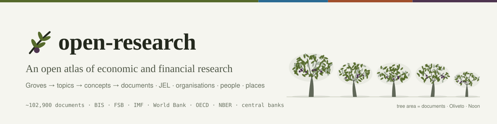
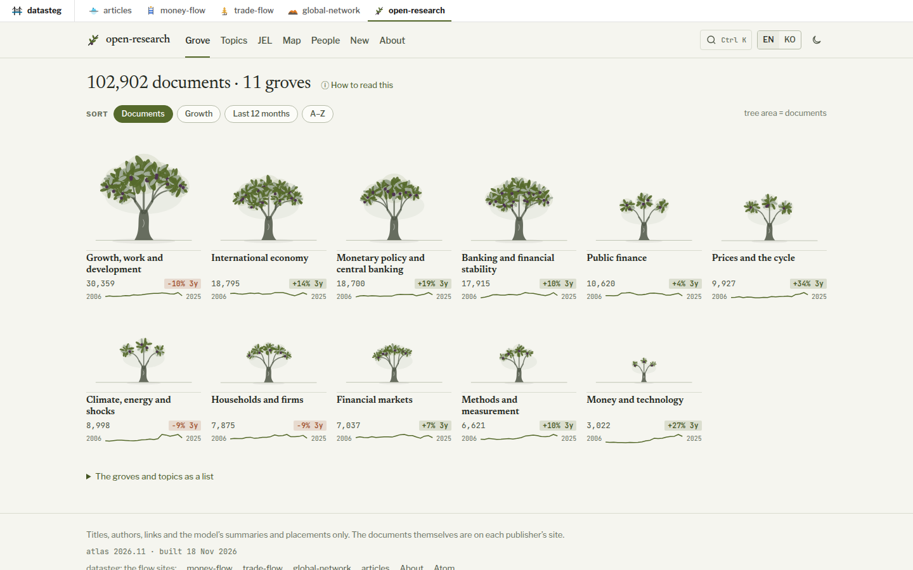
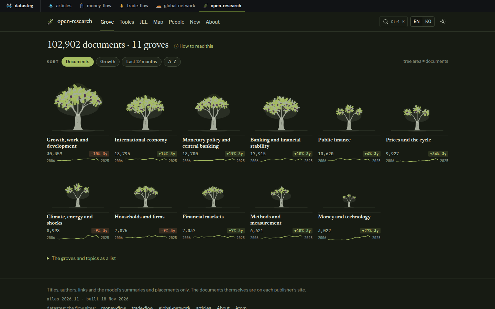
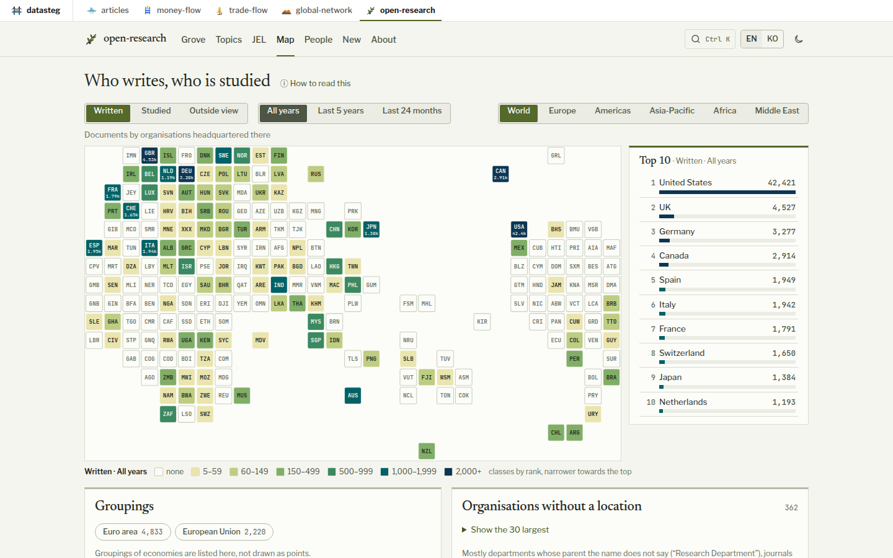
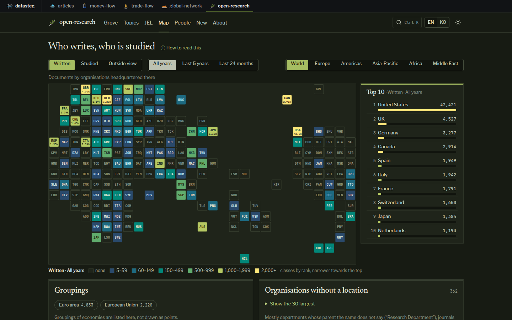

# Oliveto

Oliveto is open-research's design system. Every colour, size and stroke lives in
[`design/tokens.css`](design/tokens.css); the components are in [`design/oliveto.css`](design/oliveto.css) (prefix
`or-`), and the page compositions on top of them in [`app/app/site.css`](app/app/site.css). Nothing in a component
names a colour directly: it names a token.

## The idea

**An olive grove in summer.** A research archive is an old, slow-growing thing, so the atlas is drawn as a grove:
each of the eleven groves of topics is an olive tree, each topic a leaf cluster, and the size of a tree is its number
of documents. The page around the trees is a **drystone terrace at noon**: flat panels on pale limestone, separated by
hairlines, with a 3px top rule in the tone of the panel's publisher family. There are no floating cards and no shadows
except on things that float (tooltips, the search dialog).

The two themes are times of day. **Noon** is the light theme: limestone ground, bark ink, olive leaf. **Dusk** is the
dark one: the grove after sunset, with a deep green-black ground, pale ink and the lit leaf (`--leaf-lit`) as the
accent.

## Palette

### The grove's colours (Noon)

| Token | Hex | Role |
|---|---|---|
| `--limestone` | `#F5F5EF` | the ground: `--surface` in Noon |
| `--bark` | `#23281D` | ink: `--ink` in Noon |
| `--leaf` | `#55692B` | the accent: buttons, focus, active chips, central-bank tone |
| `--leaf-lit` | `#A6BD62` | the accent in Dusk |
| `--silver` | `#A3AE9C` | the underside of olive leaves: context marks, quiet bars |
| `--sky` | `#2B6A92` | BIS and FSB |
| `--clay` | `#A04F2C` | IMF, World Bank and OECD; falling growth |
| `--ripe` | `#4E3550` | NBER and SUERF; the olive on the mark and the trees |
| `--straw` | `#DDB64A` | highlight: the selected tile, a chart's band |

### Surfaces, lines and ink

| Token | Noon | Dusk | Use |
|---|---|---|---|
| `--surface` | `#F5F5EF` | `#171B13` | page ground |
| `--surface-raised` | `#FCFCF8` | `#1F241A` | panels, the map stage |
| `--surface-sunk` | `#EBECE3` | `#11140E` | hovered rows, segmented controls, notices |
| `--line` | `#D9DCCF` | `#2E3528` | hairlines between rows and panels |
| `--line-strong` | `#B5BBA8` | `#454E3D` | control borders, table heads, the ground line under the trees |
| `--ink` | `#23281D` | `#E8EADF` | text |
| `--ink-2` | `#4D5545` | `#BCC2B2` | secondary text, trunks and branches |
| `--ink-3` | `#687160` | `#8F9786` | kickers, captions, provenance |
| `--accent` | `#55692B` | `#A6BD62` | primary actions, focus ring, active state |
| `--accent-hover` | `#46581F` | `#B8CC78` | |
| `--link` | `#435421` | `#BFD27F` | links |

### Publisher families

The archive's publishers fall into four families. Each has a tone (charts, the panel's top rule), a text colour (on
tags) and a soft background (tag fills), set together by `.or-fam--cb`, `--bis`, `--io` and `--acad`.

| Family | Tone (Noon / Dusk) | Text (Noon / Dusk) | Soft (Noon / Dusk) |
|---|---|---|---|
| Central banks (`--cb`) | `#55692B` / `#A6BD62` | `#435421` / `#BFD27F` | `#E4EBD3` / `#26301A` |
| BIS and FSB (`--bis`) | `#2B6A92` / `#79B3DB` | `#245A7D` / `#8FC2E6` | `#DDEAF3` / `#16283A` |
| IMF, World Bank, OECD (`--io`) | `#A04F2C` / `#E39068` | `#8A4325` / `#EDA27E` | `#F4E1D7` / `#3A2217` |
| NBER and SUERF (`--acad`) | `#4E3550` / `#C59BC4` | `#4E3550` / `#D5B0D4` | `#ECE2EC` / `#2E2230` |

The chart tokens `--viz-cb`, `--viz-bis`, `--viz-io` and `--viz-acad` follow the same four tones, so a stacked bar of
documents a year reads in the same colours as the tags beside it.

### Evidence marks

Every item on a profile card carries one of three marks, and the marks have their own tokens so they look the same
everywhere:

| Mark | Meaning | Noon | Dusk |
|---|---|---|---|
| **in text** (`.or-mark--intext`) | the sentence carrying the keyword was found word for word | fill `#E4EBD3`, text `#435421` | fill `#26301A`, text `#BFD27F` |
| **found** (`.or-mark--found`) | the name or number occurs in the text or metadata | outline `--leaf`, text `#435421` | outline `--leaf-lit`, text `#BFD27F` |
| **model only** (`.or-mark--model`) | written by the model, not verified in the text | fill `#F6EBC8`, dashed `#C9A33A`, text `#7A5C0E` | fill `#33290F`, dashed `#8C7428`, text `#E8CB6A` |

The model's one-sentence summary (`.or-summary`) uses the *model only* colours with a dashed border, so a reader never
mistakes it for the publisher's words. `--warn` (`#94600F` / `#E2B547`) and `--warn-soft` mark items to merge and
warnings.

### Data colours

| Token | Noon | Dusk | Use |
|---|---|---|---|
| `--viz-axis` | `#B5BBA8` | `#4E5846` | axes |
| `--viz-grid` | `#E3E5DA` | `#262C20` | gridlines |
| `--viz-context` | `#A3AE9C` | `#5E6857` | context series, quiet bars, leaf dots in the tree list |
| `--viz-guide` | `#C9CFBF` | `#3A4232` | the guide line of the branch list |
| `--viz-band` | straw at 22% | straw at 18% | a highlighted band |

## Type

Oliveto's own font tokens are `--font-display` (Spectral, with Nanum Myeongjo and Noto Serif KR for Korean),
`--font-sans` (Noto Sans KR) and `--font-mono` (JetBrains Mono). On the live site the shared datasteg type layer
([`app/lib/ds-type.css`](app/lib/ds-type.css), loaded last) points those tokens at the family's faces: **Newsreader**
for headlines and big numbers, **Libre Franklin** for text, menus and labels, **JetBrains Mono** for codes, ids and
counts; Korean falls back to Noto Serif KR in the serif roles and Pretendard in the sans roles. All faces are
self-hosted from npm, sliced by unicode range, so an English page fetches no Hangul.

- Headlines are set at weight 600 with balanced wrapping (`h1` 26–36px fluid, `h2` 22px, `h3` 17px); in Korean they
  go to weight 700 with no letter-spacing.
- Body text is 15/1.5 with tabular figures, so counts line up in columns.
- Kickers and table heads are 11.5px uppercase with wide tracking in English, and plain (no uppercase, tight tracking)
  in Korean.
- Korean text breaks between words (`word-break: keep-all`), never inside one.
- Emphasis is bold, never italic.

## Spacing, strokes and layout

- Space steps: `--space-1` 4px, 8, 12, 16, 24, 32, `--space-7` 48px. Radii are small: 2px tags, 4px controls, pills
  only for chips.
- Strokes: `--stroke-rule` 3px (a panel's top rule), `--stroke-tile` 2px (a stat tile's left rule), `--stroke-series`
  1.5px (a line in a chart), `--stroke-hair` 1px (every divider).
- The page is at most `--width-wrap` 1200px wide with a 16px gutter (or the safe-area inset); text runs to `--measure`
  68ch. Breakpoints: `--bp-stack` 960px (columns stack), `--bp-menu` 680px, `--bp-phone` 600px.

## The tree and the map

**The grove** ([`app/components/GroveTrees.tsx`](app/components/GroveTrees.tsx)). One olive tree per grove, drawn
in SVG from the data with a seeded random sequence, so a tree looks the same on every render. Tree area is
proportional to documents (every length scales with the square root of the grove's share of the largest), so a grove
with a tenth of the documents covers a tenth of the ground. Each topic is a branch ending in a leaf cluster sized the
same way. Leaves are `--accent` with some `--silver` undersides, olives `--ripe`, trunk and branches `--ink-2`, the
crown a faint `--accent` dome that brightens on hover or focus. Under each tree: the grove's name, its count, a growth
chip (2023–2025 against 2020–2022; leaf for up, clay for down) and a sparkline of documents a year, 2006–2025. The
legend says it plainly: *tree area = documents*.

**The branch list** (`.or-tree__*`). The same tree as rows: an indented list with a guide line in `--viz-guide`, a
count, a bar and a sparkline per row; the focused row's bar takes the accent.

**The tile map** ([`app/components/TileMap.tsx`](app/components/TileMap.tsx),
[`scripts/tilegrid.py`](scripts/tilegrid.py)). Every economy is one square tile with its ISO code, placed as close to
its real position as the others allow and Pacific-centred, so Korea sits mid-map and the seam runs through the
Atlantic. Counts use a six-step ramp with breaks set from the data: in Noon pale straw to leaf to deep slate (more is
darker), in Dusk deep slate to leaf to bright straw (more is brighter), each theme's steps chosen for its own surface.
An economy with no documents is an outlined empty tile. The *outside view* (the share of an economy's research
written abroad) uses a seven-class diverging scale centred on 50%, from leaf-teal through a neutral to clay. The
selected tile takes a `--highlight` outline.

**Co-topics are a ranked list, never a network.** Related topics, organisations and places are numbered lists with
counts (and a lift for related topics); people are listed A–Z without counts.

## Components

| Component | Class | Notes |
|---|---|---|
| Masthead | `.or-masthead`, `.or-wordmark`, `.or-nav` | the olive sprig mark (a stem, four leaves in the accent, one ripe olive) beside the name; nav underlined in the accent |
| Panel | `.or-panel`, `.or-panel--quiet` | raised surface, hairline border, 3px top rule in the family tone (quiet: `--line-strong`) |
| Tags and marks | `.or-tag`, `.or-mark--*` | 11.5px, 2px radius, the family's soft fill and text colour |
| Chips | `.or-chips`, `.or-chip` | facets and sorts as pills; the active one filled with the accent |
| Breadcrumb | `.or-crumbs` | grove › group › topic › concept, with the JEL codes in mono beside the current page |
| Paper row | `.or-papers`, `.or-paper` | title linking to the publisher, authors, publisher, date, the family tag |
| Profile card | `.or-card`, `.or-summary`, `.or-kw`, `.or-kv`, `.or-prov` | sections under a hairline; keywords grouped by salience; provenance in mono |
| Stat tiles | `.or-tiles`, `.or-tile` | a 2px left rule in the tone, a display-serif number, a small caption |
| Charts | `.or-figure`, `.or-chart`, `.or-legend` | stacked bars of documents a year by family; legend swatches in the family tones |
| Controls | `.or-btn`, `.or-seg`, `.or-search` | 36px controls; segmented switches for layer, period and region on the map |
| Notice and source | `.or-notice`, `.or-source` | a sunk panel with an accent top rule; sources in 12.5px `--ink-3` |

The datasteg bar above the masthead is shared by every datasteg site and keeps its own colours, so it looks the same
whatever design system the page below it uses.

## Themes

Dusk follows the system setting (`prefers-color-scheme: dark`) unless the reader chose a theme with the sun and moon
button; the choice is saved in the browser and applied before the first paint, as `data-theme="light"` or
`data-theme="dark"` on the root. `tokens.css` defines the Dusk values twice, once under the media query (guarded by
`:root:not([data-theme="light"])`) and once under `:root[data-theme="dark"]`, so both routes give the same colours.

| | Noon | Dusk |
|---|---|---|
| The grove |  |  |
| The map |  |  |
