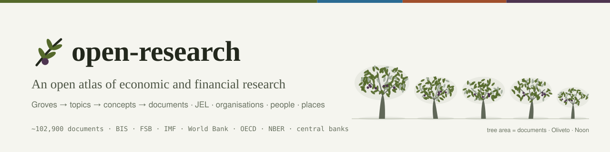
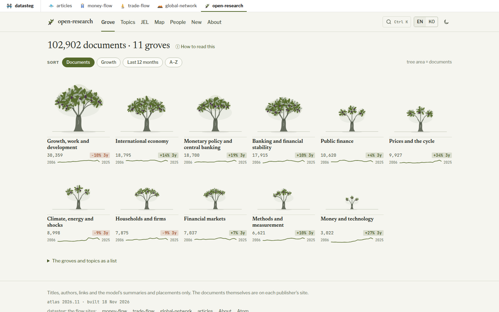
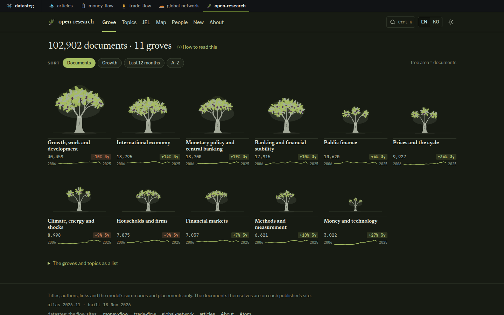
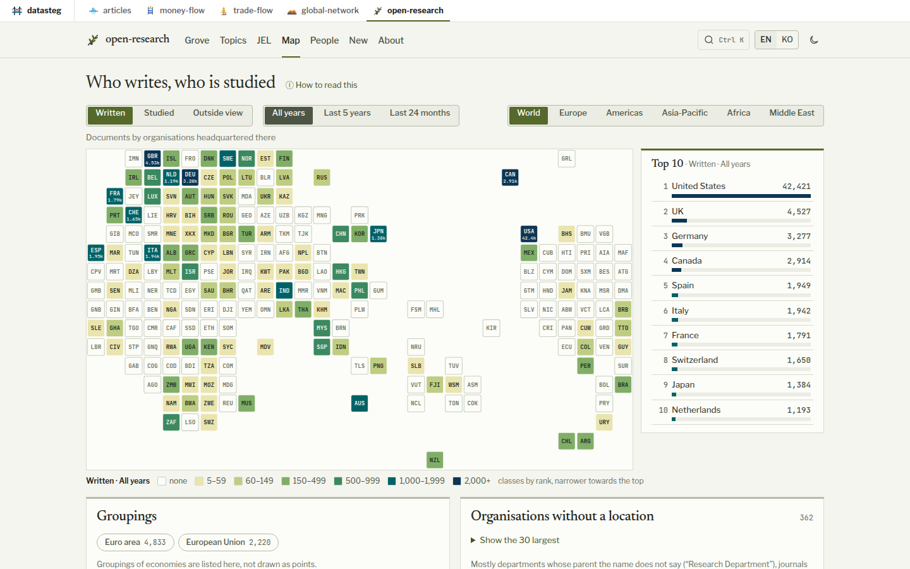
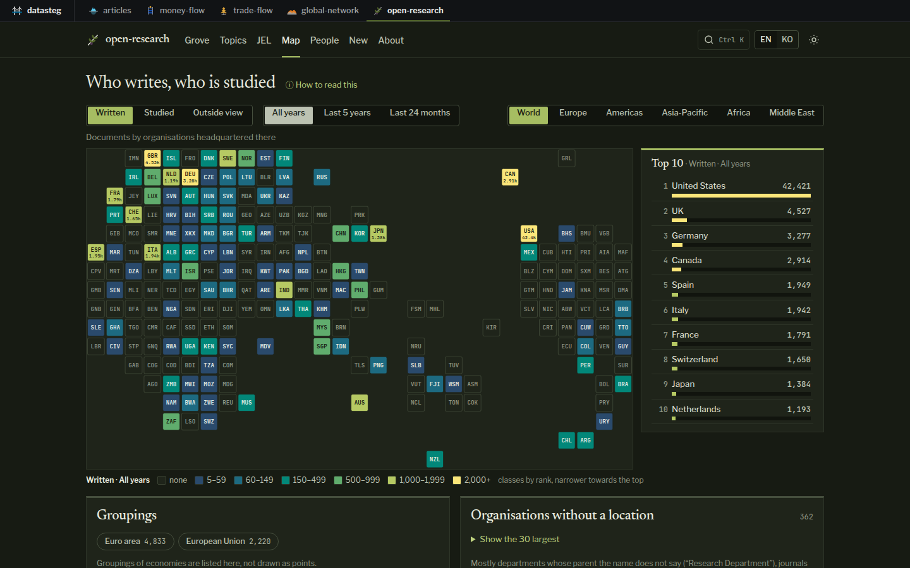
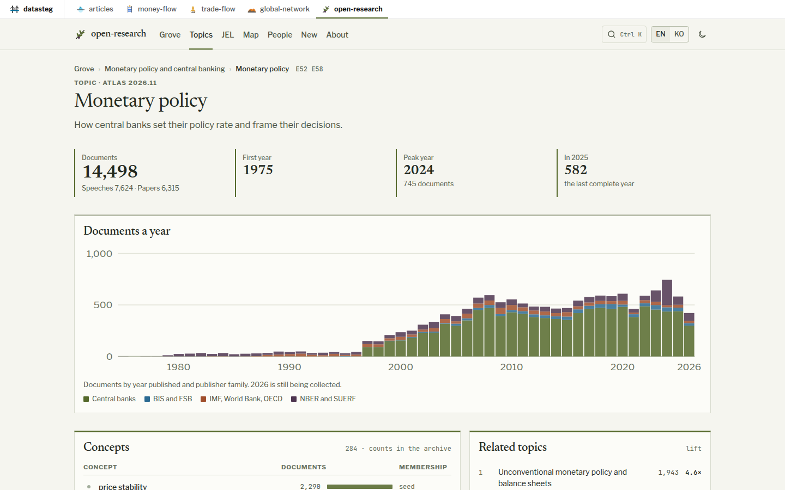

<p align="center"></p>

# open-research

**An open, bilingual atlas of public research in economics and finance.** About 102,900 papers, speeches, reports
and policy notes from the BIS, FSB, IMF, World Bank, OECD, NBER, SUERF and about 105 central banks, arranged as a
tree you can walk: **groves → topics → concepts → documents**, next to the JEL classification, and across the
organisations, people and places the documents name. English and Korean.

Live at **https://open-research.datasteg.com** · part of [datasteg](https://www.datasteg.com) ·
API and MCP server: [datasteg.com/en/technology/api](https://www.datasteg.com/en/technology/api)

This repository is a read-only snapshot of the site's code. It shows how AI agents and plain code turn a large
research archive into an open atlas: the data build, the publication rules it enforces, the site and its API views.

| Noon (light) | Dusk (dark) |
|---|---|
|  |  |
|  |  |

## What the atlas shows

- **The grove.** Eleven groves (monetary policy and central banking, banking and financial stability, international
  economy, public finance and so on), each drawn as an olive tree whose area is proportional to its documents. Each
  leaf cluster is a topic; a growth chip compares 2023–2025 with 2020–2022, and a sparkline shows documents a year.
- **Topics and concepts.** 61 topics under the groves; a concept is a normalised keyword that gets its own page from 20
  documents. A document sits in up to three topics, and every placement says why: the concepts and JEL codes that put
  it there.
- **JEL.** The JEL classification for economists, with stated codes (from the publisher) and inferred codes (from the
  model) kept apart and never added together.
- **Organisations, people, places.** Who writes and who is studied, on a tile map of economies; organisation and person
  pages with name, affiliation and role as published (no contact details, no photos, no rankings of people).
- **New.** The documents the archive received in the last 30 days, newest first, with documents a day by publisher
  family (backfill hidden, language versions folded).
- **A profile card per document.** Title, authors, publisher, series and number, date, a one-sentence summary, keywords,
  people, places and JEL codes, and the link to the publisher's own page.



## From data to publication

Each step is marked by what happens when it runs: **model** (an AI model does the work every time), **code** (plain
code, no model; AI agents wrote almost all of it and a person reviewed it) or **person** (a person decides). The same
marks are used on [datasteg.com/en/technology](https://www.datasteg.com/en/technology), which lists every step, and
[datasteg.com/en/technology/agents](https://www.datasteg.com/en/technology/agents), which lists every agent.

| # | Step | Mark | What happens |
|---|---|---|---|
| 1 | **Research archive** (upstream, not in this repository) | code | One scraper per publisher series collects working papers, speeches and bulletins from the publishers' own listings, every day, politely (a pause between requests, Retry-After honoured). If a scraper breaks, a repair agent (Claude Opus 5.5) is called; its patch is kept only if it touches the scrapers alone and their tests pass, otherwise a person takes over. |
| 2 | **Page reader** | model | For PDFs whose text layer is missing or broken, an open-weights OCR and layout model pair (PaddleOCR-VL-1.6, PP-DocLayoutV3) reads the page images. A length rule in code decides whether the new text replaces the old. |
| 3 | **Profile writer** | model | An open-weights model (Muse Glimmer 30B) writes a profile card for each document: a one-sentence summary, keywords, people, places and JEL codes. Code checks every item and marks it *in text* (the sentence was found word for word), *found* (a string check passed) or *model only*. No person approves a card; the mark travels with the item to the site. |
| 4 | **Atlas export** (upstream) | code + person | Rules normalise the names of people, organisations and places, merge spellings, and place each document on the topic tree and in the JEL index. A person sets the organisation list and the seed concepts; everything else is placed by rule. New documents are added nightly; the tree is re-released about once a month, and ids are stable (a merged node redirects). |
| 5 | **[`scripts/build.py`](scripts/build.py)** | code | Reads the atlas export, refuses a major version it was not written for or an export whose own checks failed, and writes one read-only SQLite file with FTS5 full-text search over titles, names and concepts. It enforces the publication rules below. [`scripts/geo.py`](scripts/geo.py) and [`scripts/tilegrid.py`](scripts/tilegrid.py) compute the map geometry once, at build time. |
| 6 | **Site and API views** ([`app/`](app)) | code | A Next.js server renders every page on request from the SQLite file (node:sqlite, Node 24). The same readers serve the `/svc/v1` views that the datasteg API and MCP server expose ([`api.yaml`](api.yaml)); an allow-list decides what a document view may say, and a test proves nothing else leaks ([`app/tests/svc-o2.test.mjs`](app/tests/svc-o2.test.mjs)). |
| 7 | **Korean** | model + code | The Korean interface strings come from datasteg's Korean wording model, a fine-tuned open-weights model, and a deploy gate fails on any Korean string it did not record. Korean labels are given to groves, topics and JEL letters; other labels stay in English. |
| 8 | **Release** | code | A daily check rebuilds the atlas and deploys only when it changed; a deploy counts only when the live health check names the exact build. |

### Publication rules

The site's rules (O1–O12, listed on [its About page](https://open-research.datasteg.com/en/about)) are enforced in the
build and the API views, not left to the reader:

- **Collect nothing here** (O1): the site reads the archive's export; collecting, running the models and keeping the
  registries happen upstream.
- **Metadata and links, never the text** (O2): no full text, PDFs, figures, abstracts or quoted sentences; the title
  links to the publisher's page, and copyright stays with the publishers and authors.
- **Every model-written item carries its mark** (O3): summaries, inferred JEL codes, roles and model placements.
- **One release per page** (O4), **stable ids** (O5), **a placement says why** (O6), **people as published** (O7),
  **no commercial data** (O8: a dataset a paper names appears only as a name), **stated and inferred JEL apart** (O10).

## Repository map

```
app/                    the Next.js site (App Router, React 19, TypeScript)
  app/[lang]/           pages under /en and /ko: grove, topics (t), concepts (k), JEL, map (m), places (c),
                        organisations (o), people (a), documents (p), new, search, about
  app/svc/v1/           the API views read by the datasteg API and MCP server
  app/feed/             Atom feed of the newest documents
  components/           grove trees, tile map, topic finder, search overlay, the datasteg bar
  lib/                  db.ts (the SQLite reader), svcmap.ts (the document allow-list), svcviews.ts, i18n.ts
  tests/                the allow-list test for the API views
design/                 Oliveto: tokens.css and oliveto.css (see DESIGN.md)
config/                 public reference data: economies, organisation headquarters, the tile grid, Natural Earth 110m
scripts/                build.py (atlas export → SQLite), geo.py (map geometry), tilegrid.py (the tile grid)
api.yaml                this app's side of the datasteg API: views, parameters, MCP tool descriptions
Dockerfile              the container image: Next.js standalone on Node 24 Alpine, with the SQLite file inside
```

## Design: Oliveto

The site is drawn in **Oliveto**, an olive grove in summer: flat panels on limestone separated by hairlines, a 3px top
rule in the publisher family's tone, bark ink, leaf accent and a ripe-olive purple. **Noon** is the light theme, **Dusk**
the dark one. Four tones tell the publisher families apart (central banks, BIS and FSB, IMF/World Bank/OECD, NBER and
SUERF), and three evidence marks show where an item came from. See [DESIGN.md](DESIGN.md) for the palette, type,
components and the map and tree conventions.

## About this snapshot

- **Read-only.** This is one snapshot of the code, published to show how the atlas is made. It is not set up to run on
  its own: the build needs the research archive's atlas export, which is not public. Part 1 of the allow-list test runs
  without data (`cd app && node --test tests/svc-o2.test.mjs`).
- **No data, no documents.** The repository holds no built data. The site links to each publisher's original document
  and does not redistribute it. To query the atlas, use the site or the public
  [API and MCP server](https://www.datasteg.com/en/technology/api) (`research_documents`, `research_tree` and the shared
  `search` and `fetch` tools).
- **Corrections.** If two people are merged wrongly, a document is misplaced or you want a person page taken down, the
  [About page](https://open-research.datasteg.com/en/about) says how to tell datasteg.

© datasteg. All rights reserved.
